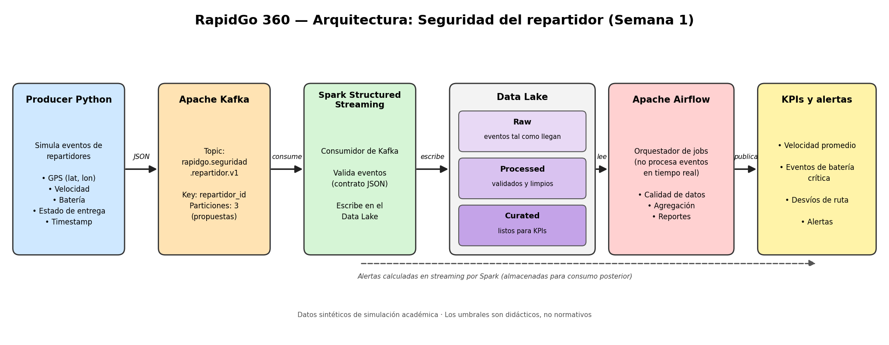

# Arquitectura de RapidGo 360

## Diagrama


```text
Producer (producer/) --> Kafka (rapidgo.seguridad.repartidor.v1 - 3 particiones)
                                    |
                                    v
                  Spark Structured Streaming (spark/datalake.py)
                     /              |               \
                    v               v                v
            datalake/raw/   datalake/processed/   datalake/curated/
                                    |
                                    v
        Apache Airflow (DAG rapidgo_seguridad_semanal: 5 tareas batch)
                                    |
                                    v
              Reportes auditados (agregados.csv / reporte.json)
```

## Componentes
| Componente | Qué hace | Recibe | Entrega |
|---|---|---|---|
| **Producer** (`producer/`) | Genera eventos sintéticos de telemetría de repartidores (GPS, velocidad, batería, estado y desvío) e inyecta casos controlados para pruebas. | Parámetros CLI (`--bootstrap-servers`, `--rounds`, `--riders`, `--seed`). | Eventos JSON publicados en Kafka usando `repartidor_id` como clave de partición. |
| **Kafka** (`docker-compose.yml`) | Recibe y distribuye en tiempo real el flujo de eventos garantizando el orden secuencial por repartidor. | Mensajes JSON del Producer en el puerto `9092` (externo) / `29092` (interno). | Topic `rapidgo.seguridad.repartidor.v1` dividido en 3 particiones (`replication-factor: 1`). |
| **Spark** (`spark/datalake.py`, `spark/reglas.py`) | Consume el stream desde Kafka, valida el contrato de datos (sin imputar nulos ni valores fuera de rango), aplica ventanas temporales con *watermark* y evalúa KPIs y alertas. | Flujo de mensajes desde Kafka (`--offsets earliest`). | Archivos Parquet particionados en `datalake/raw`, `datalake/processed` y `datalake/curated`. |
| **Data Lake** (`datalake/`) | Almacena de forma columnar e inmutable los eventos por capas junto con los checkpoints de estado del streaming. | Escrituras Parquet desde Spark en `/workspace/datalake`. | Capa `raw` (todos los eventos), `processed` (solo eventos válidos con `fecha` y `hora`) y `curated` (`kpi_velocidad` y `alertas`). |
| **Airflow** (`airflow/dags/rapidgo_seguridad.py`) | Orquesta el pipeline semanal en 5 tareas secuenciales (`verificar_fuente` → `validar_calidad` → `agregar_datos` → `generar_reporte` → `auditar_salida`) con 2 reintentos cada 30 s. | Archivos Parquet de `datalake/processed` montados en `/opt/airflow/datalake`. | `manifest_fuentes.json`, `validos.parquet`, `rechazados.jsonl`, `agregados.csv` y `reporte.json` auditado. |